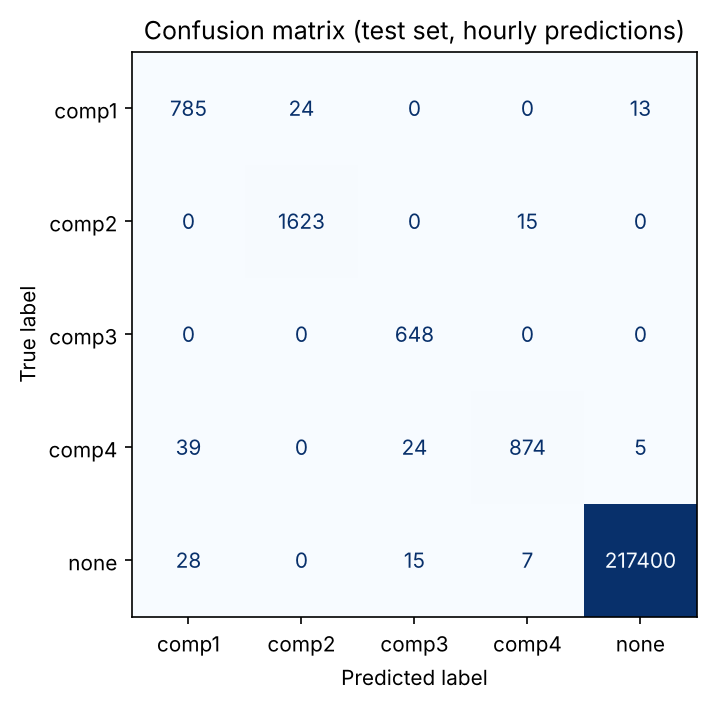
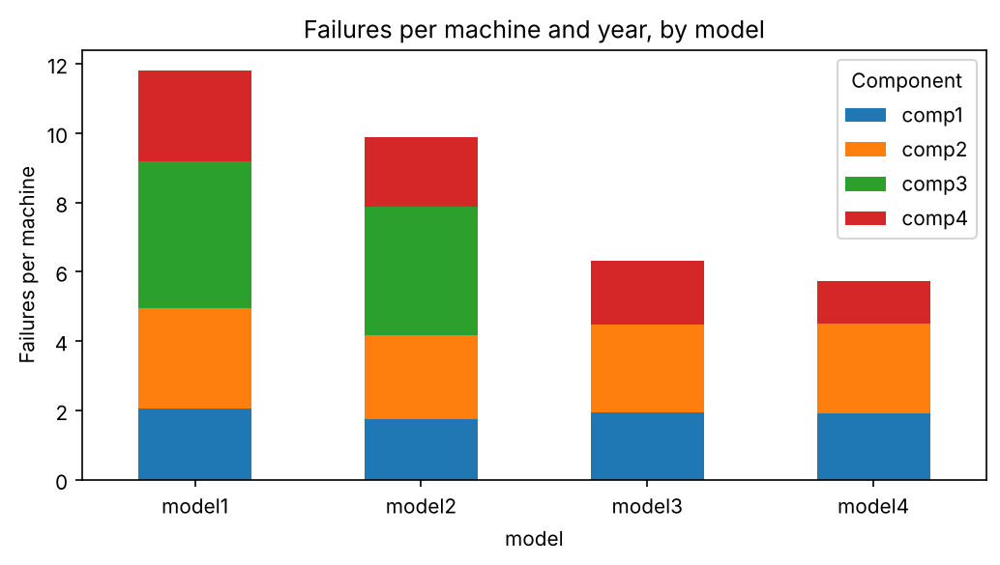
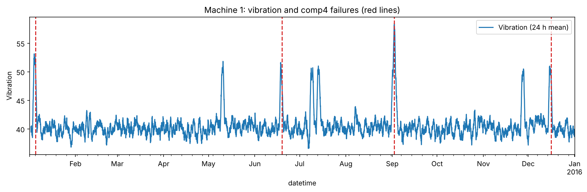
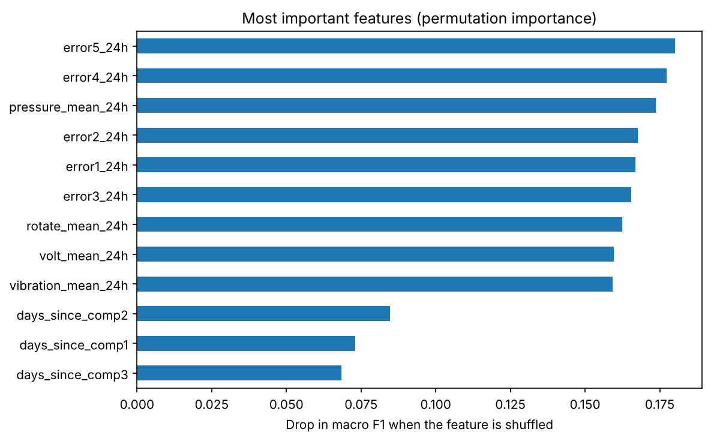

# Predictive Maintenance: Forecasting Component Failures from Machine Data

Predicting **whether a machine will have a component failure within the next 24 hours, and which component**, from hourly sensor data, warning messages and maintenance records.

The goal is the kind of decision a service team faces every day: which machine should a technician visit next, and which spare part should they bring?

## Results at a glance

Evaluated on **October to December**, after training on January to August (time-based split, no overlap):

| Component | Precision | Recall |
|---|---|---|
| comp1 | 0.92 | 0.95 |
| comp2 | 0.99 | 0.99 |
| comp3 | 0.94 | 1.00 |
| comp4 | 0.98 | 0.93 |

*Metrics are per hour. Each failure produces 24 labelled hours before it occurs.*



Out of more than 217,000 normal hours, only 50 triggered a false alarm. Most remaining errors are not missed failures but a mix-up of **which** component will fail (mainly comp4 predicted as comp1).

## Dataset

[Microsoft Azure Predictive Maintenance dataset](https://www.kaggle.com/datasets/arnabbiswas1/microsoft-azure-predictive-maintenance): 100 machines, one year (2015), simulated data.

| Table | One row means |
|---|---|
| telemetry | hourly mean of voltage, rotation, pressure and vibration (876,100 rows) |
| errors | a warning message, the machine keeps running (3,919) |
| maint | a component was replaced, scheduled or after a failure (3,286) |
| failures | a component failed (761) |
| machines | model and age of each machine (100) |

## Key findings from the exploratory analysis

**1. Which parts fail most often?**



- comp2 fails most often overall.
- **comp3 only fails in model1 and model2**, where it is the most frequent failure. In model3 and model4 it is maintained but never fails.
- model1 has about twice as many failures per machine as model4. This is not explained by age: model1 and model3 have the same average age (about 12 years), but model1 fails far more often because of comp3.
- Older machines fail more often overall (about 9 failures per year above 10 years of age, about 6 below).

**2. Failures announce themselves**



Vibration of machine 1 rises about one to two days before each comp4 failure (red lines). But there are also peaks without a failure, so a single sensor would produce false alarms.

Each component has its own warning signature in the 24 hours before it fails:

| Component | Typical warning | Deviating sensor |
|---|---|---|
| comp1 | error1 | voltage up |
| comp2 | error2, error3 | rotation down |
| comp3 | error4 | pressure up |
| comp4 | error5 | vibration up |

Only 20 to 50 % of warnings are followed by a failure within 24 hours, so warnings alone are not enough either. The model combines all signals.

## Approach

### Features (one row = one machine at one hour, using only past information)
- **Sensors:** mean and standard deviation over the last 24 hours
- **Warnings:** number of each error type in the last 24 hours
- **Maintenance history:** days since each component was last replaced (`merge_asof` on the maintenance log)
- **Machine metadata:** model (one-hot) and age

### Target
For each row, the next failure of the same machine is looked up. If it occurs within 24 hours, the label is that component, otherwise `none`. About **98 % of rows are `none`**, so accuracy is meaningless here and the evaluation focuses on precision and recall per component.

### Train/test split
The task is to predict the future, so the data is split **by time**, not randomly: training January to August, test October to December. September is left out so that no 24-hour target window overlaps both sets.

### Model
`HistGradientBoostingClassifier` with balanced class weights, chosen because:
- the relationships are non-linear (comp3 only fails in two models, vibration only matters for comp4), which tree models capture well
- it is fast on several hundred thousand rows
- it needs no feature scaling

## Feature importance



Permutation importance on a balanced test sample shows:
- **Warnings and sensor levels** drive the predictions.
- **Days since the last replacement** help moderately.
- **Sensor variability, machine age and model** contribute almost nothing.

For short-term failure prediction, the **current state** of a machine matters far more than its static properties.

## Why the scores are so high

The data is **simulated**: every component announces its failure through a clear, dedicated warning and sensor pattern. Real device data is noisier, so real-world performance would be lower.

The high scores are **not** caused by data leakage:
- all features use only information available at prediction time
- an intermediate column with each machine's yearly failure count was deliberately excluded, since it contains future information
- the test period lies strictly after the training period

## Limitations and next steps

- Simulated data; results will not transfer one-to-one to real devices.
- Metrics are hourly. An event-level evaluation (how many failures were caught, and how many hours in advance) would be closer to how a service team works.
- Only one model and one 24-hour horizon were tested. Longer horizons, trend features or a comparison with simpler baselines are natural next steps.
- When several components fail at the same hour (42 cases), only one of them is used as the label.

## Tech stack

Python, pandas, NumPy, scikit-learn, Matplotlib

## How to run

Open `PredictiveMaintenance.ipynb` in Google Colab or Jupyter and run all cells. The first cell downloads the data from a public GitHub mirror of the dataset.

```bash
pip install numpy pandas scikit-learn matplotlib
jupyter notebook PredictiveMaintenance.ipynb
```

## License

The code in this repository is released under the MIT License. The dataset is not covered by this license; see the dataset source above.
